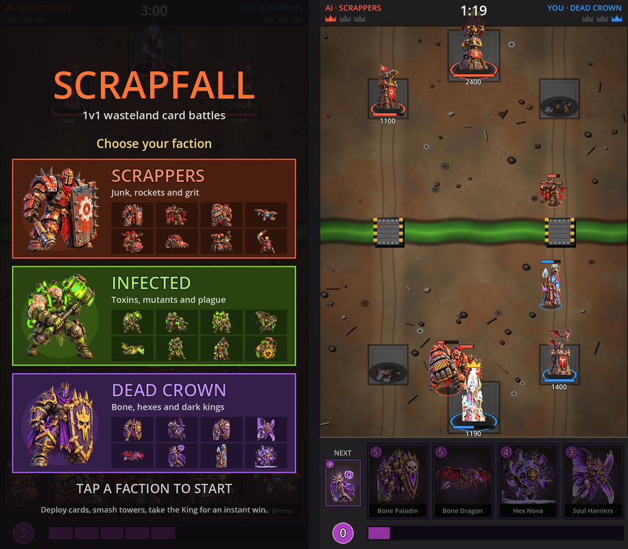

# Scrapfall

A 1v1 real-time card battler set in a scrap-metal wasteland. Pick one of three
factions (**Scrappers**, **Infected** or **Dead Crown**), then fight a computer
opponent across two lanes and a river of toxic sludge with elixir, princess
towers and a king tower. Built with **Godot 4** and GDScript.

The characters, towers and spells are cut straight from the Scrapfall concept
sheets (see [Art](#art)).



## How to open and play it

1. Download **Godot 4** (4.3 or newer, the standard version, *not* the .NET one) from
   <https://godotengine.org/download>. Unzip it; there's nothing to install.
2. Download this repository: on GitHub press **Code → Download ZIP**, then unzip it.
3. Start Godot. In the Project Manager click **Import**, browse to the unzipped
   folder and pick `project.godot`, then click **Import & Edit**.
4. Press the **Play** button (▶) at the top right, or press **F5**.

## How to play

- Tap a faction on the start screen. The computer picks one of the other two.
- Tap (or click) a card, then tap your half of the arena to deploy it. You can also drag a card onto the arena.
- Cards cost elixir. Elixir refills over time, up to 10. In the last minute it refills twice as fast.
- Destroy a princess tower to earn a crown and unlock deploying on that side of the enemy's half.
- Destroying the king tower wins instantly. Otherwise, after 3 minutes the side with more crowns wins.
  If crowns are tied there's 1 minute of sudden-death overtime, then the side whose weakest tower is healthier wins.
- The king tower sleeps until it's hit or one of its princess towers falls.

## Factions and cards

Each faction has its own 8-card deck, princess towers, king tower and tower ammo.

**Scrappers**: Scrap Watchtowers, Rocket Nest king, scrap rockets.

| Card | Cost | What it does |
| --- | --- | --- |
| Rivet Warden | 3 | Shield brawler with a spiked mace. |
| Signal Sniper | 4 | Long-range marksman. Hits air and ground. |
| Scrap Colossus | 5 | Huge tank. Only attacks buildings. |
| Scrap Drones | 3 | Three flying scout drones. |
| Rocket Rider | 4 | Flying raider. Splash damage on ground troops. |
| Boom Buggy | 2 | Rushes a building and explodes. |
| Turret Tinker | 4 | Defensive turret. Hits air and ground. |
| Rocket Barrage | 4 | Rocket strike anywhere on the map. |

**Infected**: Toxic Sprayer towers, Hive Mother king, blight rockets.

| Card | Cost | What it does |
| --- | --- | --- |
| Serum Mauler | 3 | Hammer-swinging mutant brute. |
| Mutation Marksman | 4 | Chem sniper. Hits air and ground. |
| Hazmat Juggernaut | 5 | Armoured tank. Only attacks buildings. |
| Plague Gliders | 3 | Two gliders. Hit air and ground. |
| Fat Dragon | 5 | Flying tank with toxic splash breath. |
| Smog Caster | 4 | Lobs toxin that splashes ground troops. |
| Chem Turret | 4 | Toxic turret. Splash on ground troops. |
| Blight Cloud | 4 | Poison cloud. Damage over 4 seconds. |

**Dead Crown**: Gargoyle Roost towers, Soul Obelisk king, hex orbs.

| Card | Cost | What it does |
| --- | --- | --- |
| Crown Bastion | 4 | Armoured shield wall. |
| Hex Archers | 3 | Two crystal-bow archers. Hit air and ground. |
| Bone Paladin | 5 | Undead tank. Only attacks buildings. |
| Soul Harriers | 3 | Two winged blades. Hit air and ground. |
| Bone Dragon | 5 | Flying arcane destroyer. Splash damage. |
| Soul Seer | 4 | Cursed mage. Splash hits air and ground. |
| Obelisk Priest | 4 | Summoned obelisk. Hits air and ground. |
| Hex Nova | 4 | Arcane burst anywhere on the map. |

Card stats and faction decks live in `scripts/cards.gd`, so balancing is a matter of editing numbers there.

## Art

Prototype art comes from the concept sheets: each character is cut out with
an AI background remover, trimmed and saved as a transparent PNG in
`art/sprites/`. In game the sprites get simple motion (walk bob and sway,
idle breathing, a squash and lunge on attack, a white hit flash, a drop-in
when deployed, hovering for fliers). The arena floor is painted by a script.

To re-cut the sprites, put the concept sheets in `tools/concept_sheets/`
(named as in `tools/extract_sprites.py`) and run:

```sh
python3 -m pip install "rembg[cpu]" scipy pillow numpy
python3 tools/extract_sprites.py      # writes art/sprites/*.png
python3 tools/make_arena.py           # writes art/arena.png
```

**For launch** the cut-outs need replacing. Concept art is a single
front-ish pose per character, has baked-in lighting from a studio backdrop,
and some cut-outs carry bits of neighbouring characters. A shipping game
needs, per unit:

- A clean, consistent top-down 3/4 view (the camera angle of the arena), on a transparent background.
- Animation: idle, walk, attack and death, either as sprite sheets
  (8 to 12 frames each, ideally 4 or 8 facing directions) or as a rigged 3D
  model rendered to sprites or used directly in Godot.
- Separate effect sprites (muzzle flashes, projectiles, spell bursts) and tower destruction states.

`docs/ART.md` has a ready-to-use brief for producing those.

## Project layout

| File | Purpose |
| --- | --- |
| `scenes/main.tscn` | The only scene; everything else is created from code. |
| `scripts/game.gd` | Match controller: factions, towers, elixir, hands, deploying, damage, collisions, win rules. |
| `scripts/unit.gd` | Troops and buildings: targeting, bridge pathing, attacking. |
| `scripts/tower.gd` | King and princess towers. |
| `scripts/ai.gd` | The computer opponent. |
| `scripts/hud.gd` | Cards, elixir bar, timer, crowns, placement preview, start and end screens. |
| `scripts/cards.gd` | Factions and card data. |
| `scripts/art.gd` | Sprite drawing helpers. |
| `scripts/spell.gd` | Spells: lobbed bursts and lingering poison. |
| `art/sprites/` | Character, tower, spell and projectile sprites. |
| `art/arena.png` | Arena floor. |
| `tools/` | Sprite cutting and arena painting scripts (ignored by Godot). |
| `scripts/arena.gd` | Arena layout constants. |

## Automated check

Two AIs can play a whole match with no window, which is a quick way to check
that nothing crashes:

```sh
godot --headless --fixed-fps 60 -- --autotest
```

It picks random factions, prints a line like `AUTOTEST_RESULT winner=0 crowns=3-1 ... factions=infected/scrappers` and exits.
